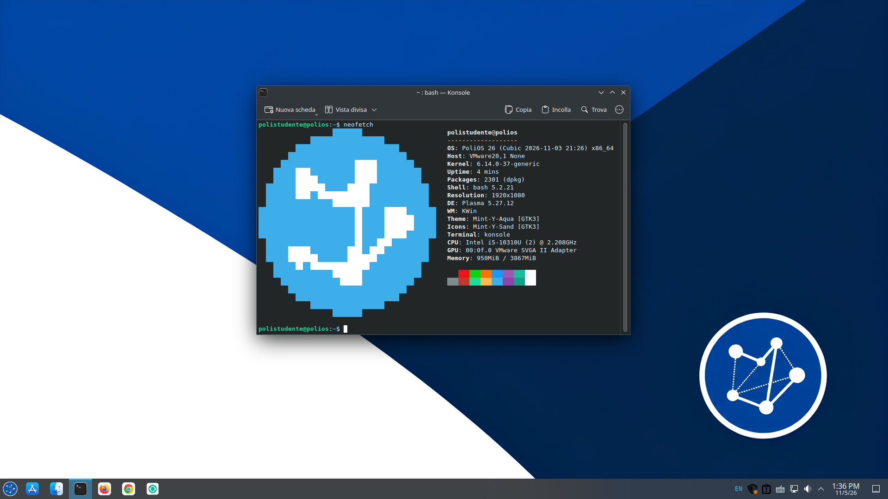

<div align="center">

# PoliOS

**🇮🇹 [Italiano](#it) · 🇬🇧 [English](#en)**

*Linux Mint + KDE Plasma per gli studenti del Politecnico di Milano · Linux Mint + KDE Plasma for Politecnico di Milano students*

> ⚠️ **Beta** · 🇮🇹 Versione di test: può avere difetti, non usarla come unico sistema. · 🇬🇧 Test version: expect rough edges, don't use it as your only system.

 

</div>

---

<a id="it"></a>

# 🇮🇹 Italiano

## Cos'è

PoliOS è una distribuzione Linux pensata per chi al Politecnico di Milano ha corsi che richiedono Linux ma non vuole perdere tempo a configurarlo. È basata su **Linux Mint 22.3** (che a sua volta si basa su Ubuntu 24.04), con **KDE Plasma** al posto di Cinnamon: un desktop con barra delle applicazioni e menu di avvio, familiare a chi viene da Windows.

- **Leggera e senza fronzoli**: niente snap; le app extra si installano con Flatpak (o con `apt`, se sai usare il terminale).
- **Compatibile con le istruzioni dei corsi**: usa `apt` come Ubuntu/Debian, quindi i comandi dei prof funzionano così come sono, e per i problemi basta cercare "`<problema>` Ubuntu".
- **Pronta all'uso**: italiano di default, Wi-Fi del Politecnico configurabile al primo avvio, software dei corsi installabile con un clic.
- **Pensata per le macchine virtuali** (VirtualBox, VMware, UTM) **e per il dual boot**.

## Come si usa

Al primo accesso si apre **PoliOS Welcome**, una procedura guidata (in italiano, con pulsante per l'inglese):

1. **Wi-Fi del Politecnico**: inserisci codice persona e password per la rete `polimi-protected` (il certificato è già incluso). Nelle macchine virtuali questa pagina non compare, perché non c'è un adattatore Wi-Fi. Si può saltare.
2. **I tuoi corsi**: spunta i corsi che segui; il software necessario viene scaricato e installato. L'elenco dei corsi viene **aggiornato online** dal repository, quindi nuovi corsi arrivano senza dover scaricare una nuova ISO. Qui trovi anche **Google Chrome**, scaricato direttamente da Google.

Puoi riaprire la procedura in qualsiasi momento dal menu ("PoliOS Welcome"), per esempio per aggiungere corsi o aggiornare la password del Wi-Fi (semmai la dovessi cambiare).

## Cosa include

| Categoria | Software |
|---|---|
| Desktop | KDE Plasma 5.27 (sessione X11), icone WhiteSur, sfondo, schermata di avvio e di login PoliOS |
| File e documenti | Dolphin, Okular (PDF), Ark (archivi), KCalc, gedit |
| Immagini e video | Visualizzatore immagini GNOME (eog), Totem, codec multimediali |
| Terminale | Konsole, `git`, `curl`, `wget`, `neofetch` |
| Browser e studio | Firefox, **WeBeep Sync** ([toto04/webeep-sync](https://github.com/toto04/webeep-sync)) |
| Sistema | Flatpak, stampa (CUPS), plugin VPN, firmware e microcode |
| Per corso | scelto da te in PoliOS Welcome ([motocarro/polios-welcome](https://github.com/motocarro/polios-welcome)) (vedi [`courses.conf`](polios-cubic/welcome/courses.conf)) |

Software proprietario come Vivado **non** è incluso (non è ridistribuibile). Alcune app di Linux Mint (per esempio il gestore degli aggiornamenti) possono essere ancora presenti.

## A chi è rivolta (e a chi no)

**Per**: studenti che hanno bisogno di Linux per i corsi, soprattutto in macchina virtuale o in dual boot.
**Non per**: chi usa software senza versione Linux (se il tuo corso lo richiede, PoliOS non può aiutarti); chi cerca un sistema generico per tutti i giorni (come Kali, serve a svolgere un lavoro preciso); chi è già soddisfatto di WSL.

## Stato

### Cosa funziona

- Avvio live e installazione completa
- Desktop PoliOS (pannello, sfondo, schermata di login, schermata di avvio)
- PoliOS Welcome in italiano e inglese, con elenco corsi
- WeBeep Sync, Konsole e le app elencate sopra

### Ancora da verificare

<!-- TODO: aggiornare questa lista man mano che le cose vengono verificate! -->
- Configurazione Wi-Fi `polimi-protected` su una rete reale
- Installazione su hardware reale e in dual boot (vedi tabella dei test)
- Aggiornamento online dell'elenco dei corsi

### Limitazioni note

- **Solo amd64**. Su Mac Apple Silicon e iPad, UTM può solo *emulare* l'immagine:funziona eh, è molto lenta.
- **Plasma 5.27 e sessione X11** (è la versione di Ubuntu 24.04, base di Mint 22.3).
- Alcune app di Linux Mint (GTK) restano nel sistema e potrebbero non seguire il tema di KDE.

## Requisiti hardware

| Hardware | Richiesto | Consigliato |
|---|---|---|
| CPU | 2 core / 2 thread, 64 bit | 4 core / 4 thread, 64 bit |
| RAM | 4 GiB | 16 GiB |
| Spazio su disco | 24 GiB | 64 GiB |
| Schermo | uno schermo | 1920×1080 |
| GPU | non richiesta | AMD Radeon qualsiasi |
| USB (solo bare metal) | 1× USB-A 2.0 | 1× USB 3.0 (A o C) |

## Testato su

<!-- TODO: aggiungere i dispositivi su cui hai provato PoliOS -->
Dispositivo: _Thinkpad T14 Gen 1 20S1 con macOS Sonoma 14.7.1_ · Le prestazioni possono variare.

| Ambiente | Live | Installazione | Strumenti VM | Note |
|---|---|---|---|---|
| *VirtualBox* | | | | |
| *VMware* | Funziona | Funziona | Funziona | *Testato su VMWare Fusion 26H2u1 per macOS.* |
| *UTM (Apple Silicon)* | | | | |
| *Bare metal* | | | | |

## Download e installazione

1. Scarica l'ultima ISO: **[link](https://youtube.com/watch?v=dQw4w9WgXcQ)** (circa 3,4 GB). Controlla la somma di controllo SHA-256: `88804f233078954519ba87cbe79d96439e3e8a6010fb4358a7ff7707c015c056`.
   *(L'ISO supera il limite di 2 GiB di GitHub Releases: è ospitata altrove. In ogni release trovi link e checksum.)*
2. Segui la guida passo passo: **[docs/INSTALL.md](docs/INSTALL.md)**.

In breve:
- **Macchina virtuale**: crea una VM, collega l'ISO e avviala. In VirtualBox scegli il controller grafico *VMSVGA*; in UTM un display *virtio-gpu*. Assegna almeno 4 GiB di RAM e 24 GiB di disco.
- **Computer reale**: scrivi l'ISO su una chiavetta USB e avvia da lì. Per il dual boot fai prima un backup dei tuoi dati.
- Prova la sessione live, poi avvia l'installazione dal desktop.

## Compilare da sorgente

Serve la ISO di Linux Mint 22.3 e [Cubic](https://github.com/PJ-Singh-001/Cubic). In breve: crea un progetto Cubic dalla ISO originale, copia la cartella [`polios-cubic/`](polios-cubic/) nel terminale di Cubic ed esegui `bash polios-cubic.sh`. I dettagli (e cosa fa lo script) sono in [`polios-cubic/README.md`](polios-cubic/README.md).

```
.
├── polios-cubic/            kit di compilazione: script, asset, file di configurazione
│   └── welcome/             PoliOS Welcome (courses.conf = elenco corsi, polios.conf = impostazioni)
├── docs/INSTALL.md          guida all'installazione
└── .github/                 modelli di segnalazione, controlli automatici, CODEOWNERS
```

## Come contribuire

- **Qualcosa non va?** Apri una [segnalazione](../../issues/new/choose): indica dove lo hai provato (VM o hardware), cosa ti aspettavi e cosa è successo. Gli screenshot aiutano.
- **Manca il software del tuo corso?** Usa il modulo "Richiesta corso/software", oppure proponi una modifica a [`courses.conf`](polios-cubic/welcome/courses.conf) con una pull request (ogni modifica viene controllata in automatico e rivista).
- Vedi anche [CONTRIBUTING.md](CONTRIBUTING.md). Per problemi di sicurezza: [SECURITY.md](SECURITY.md).

## Rete e privacy

PoliOS non aggiunge telemetria. La procedura guidata si collega a: GitHub (`raw.githubusercontent.com`) per l'elenco dei corsi, i repository di sistema (apt, Flathub) per installare il software, e Google solo se scegli Chrome. La password del Wi-Fi è salvata da NetworkManager nel sistema, non da PoliOS.

## Autori

<table>
<tr>
<td align="center"><a href="https://github.com/motocarro"><br><sub><b>motocarro</b></sub></a></td>
<td align="center"><a href="https://github.com/cliccato"><br><sub><b>cliccato</b></sub></a></td>
</tr>
</table>

Progetto ospitato da [PoliNetwork](https://github.com/PoliNetworkOrg), realizzato da studenti per gli studenti.

## Licenza e marchi

- Codice e configurazioni del progetto: **GNU GPL-3.0** (vedi [LICENSE](LICENSE)).
- PoliOS **non è un prodotto ufficiale** del Politecnico di Milano, di Linux Mint, Canonical/Ubuntu, KDE o Google, e non è approvato da essi. <!-- TODO: conferma con PoliNetwork la formula sul Politecnico -->
  "Linux Mint" è un marchio di Linux Mint; "Ubuntu" è un marchio di Canonical Ltd.; "KDE" e "Plasma" sono marchi di KDE e.V.; "Google Chrome" è un marchio di Google LLC. Nome e logo PoliNetwork appartengono a PoliNetwork.
- Il software incluso resta sotto le proprie licenze, tra cui: WeBeep Sync (GPL-3.0), tema di icone WhiteSur (GPL-3.0), tema di avvio basato su Plymouth (GPL-2.0+), PyQt5 usato da PoliOS Welcome (GPL-3.0). Il software proprietario (per esempio Vivado, Google Chrome) non viene ridistribuito nell'ISO.
- Il certificato `cachain_geant_harica.pem` (catena di certificati pubblici per il Wi-Fi del Politecnico) è incluso.

---

<a id="en"></a>

# 🇬🇧 English

## What is it

PoliOS is a Linux distribution for students at Politecnico di Milano whose courses need Linux and who don't want to spend time setting it up. It's based on **Linux Mint 22.3** (itself based on Ubuntu 24.04), with **KDE Plasma** instead of Cinnamon: a desktop with a taskbar and a start menu, familiar to Windows users.

- **Light and no-nonsense**: no snaps; extra apps come from Flatpak (or `apt`, if you know the terminal).
- **Compatible with course instructions**: it uses `apt` like Ubuntu/Debian, so your professors' commands work as written, and for problems you can search "`<problem>` Ubuntu".
- **Ready to use**: Italian by default, Polimi Wi-Fi set up at first boot, course software installable in one click.
- **Built for virtual machines** (VirtualBox, VMware, UTM) **and dual boot**.

## How it works

At first login **PoliOS Welcome** opens, a guided wizard (Italian by default, with an English button):

1. **Polimi Wi-Fi**: enter your codice persona and password for the `polimi-protected` network (the certificate is already included). In virtual machines this page doesn't appear, since there is no Wi-Fi adapter. You can skip it.
2. **Your courses**: tick the courses you follow; the software they need is downloaded and installed. The course list is **updated online** from this repository, so new courses arrive without a new ISO. **Google Chrome** is here too, downloaded directly from Google.

You can reopen the wizard any time from the menu ("PoliOS Welcome"), for example to add courses or update your Wi-Fi password (Polimi passwords expire periodically).

## What's included

| Category | Software |
|---|---|
| Desktop | KDE Plasma 5.27 (X11 session), WhiteSur icons, PoliOS wallpaper, boot and login screens |
| Files and documents | Dolphin, Okular (PDF), Ark (archives), KCalc, gedit |
| Images and video | GNOME Image Viewer (eog), Totem, multimedia codecs |
| Terminal | Konsole, `git`, `curl`, `wget`, `neofetch` |
| Browser and study | Firefox, **WeBeep Sync** ([toto04/webeep-sync](https://github.com/toto04/webeep-sync)) |
| System | Flatpak, printing (CUPS), VPN plugins, firmware and microcode |
| Per course | chosen by you in PoliOS Welcome ([motocarro/polios-welcome](https://github.com/motocarro/polios-welcome)) (see [`courses.conf`](polios-cubic/welcome/courses.conf)) |

Proprietary software such as Vivado is **not** included (it can't be redistributed). Some Linux Mint apps (for example the update manager) may still be present.

## Who is it for (and who isn't it)

**For**: students who need Linux for their courses, especially in a virtual machine or dual boot.
**Not for**: people using software with no Linux version (if your course needs it, PoliOS can't help); people looking for a general-purpose everyday system (like Kali, it's meant to get specific work done); people already happy with WSL.

## Status (beta)

### What works

- Live boot and full installation
- PoliOS desktop (panel, wallpaper, login screen, boot splash)
- PoliOS Welcome in Italian and English, with the course list
- WeBeep Sync, Konsole and the apps listed above

### Still to be verified

<!-- TODO: keep this list in sync with the Italian one -->
- `polimi-protected` Wi-Fi setup on a real network
- Installation on real hardware and in dual boot (see the test table)
- Online course list update 

### Known limitations

- **amd64 only**. On Apple Silicon Macs and iPads, UTM can only *emulate* the image: it is very slow.
- **Plasma 5.27 and X11 session** (the version in Ubuntu 24.04, the base of Mint 22.3).
- The login screen is Linux Mint's, with a PoliOS background.
- Some Linux Mint (GTK) apps remain in the system and don't follow the KDE theme.

## Hardware requirements

<!-- TODO: keep in sync with the Italian one -->
| Hardware | Required | Recommended |
|---|---|---|
| CPU | 2 cores / 2 threads, 64-bit | 4 cores / 4 threads, 64-bit |
| RAM | 4 GiB | 8 GiB |
| Disk space | 24 GiB | 64 GiB |
| Display | a display | 1920×1080 |
| GPU | not required | AMD Radeon |
| USB (bare metal only) | 1× USB-A 2.0 | 1× USB 3.0 (A or C) |

## Tested on

<!-- TODO: fill in with the devices you tried PoliOS on -->
Device: ThinkPad T14 Gen 1 running macOS Sonoma 14.7.1 · YMMV.

| Environment | Live | Install | VM tools | Notes |
|---|---|---|---|---|
| *VirtualBox* | | | | |
| *VMware* | Works | Works | Works | *tested on VMWare Fusion 26H2u1 for macOS.* |
| *UTM (Apple Silicon)* | | | | |
| *Bare metal* | | | | |

## Download and install

1. Download the latest ISO: **[link](polinetwork.org)** (about 3,4 GB). Check the SHA-256 checksum: `88804f233078954519ba87cbe79d96439e3e8a6010fb4358a7ff7707c015c056`.
   *(The ISO exceeds GitHub Releases' 2 GiB limit, so it is hosted elsewhere. Each release has the link and checksum.)*
2. Follow the step-by-step guide: **[docs/INSTALL.md](docs/INSTALL.md)**.

In short:
- **Virtual machine**: create a VM, attach the ISO and boot. In VirtualBox choose the *VMSVGA* graphics controller; in UTM a *virtio-gpu* display. Give it at least 4 GiB of RAM and 25 GiB of disk.
- **Real computer**: write the ISO to a USB stick and boot from it. For dual boot, back up your data first.
- Try the live session, then start the installer from the desktop.

## Building from source

You need the Linux Mint 22.3 ISO and [Cubic](https://github.com/PJ-Singh-001/Cubic). In short: create a Cubic project from the original ISO, copy the [`polios-cubic/`](polios-cubic/) folder into Cubic's terminal and run `bash polios-cubic.sh`. Details (and what the script does) are in [`polios-cubic/README.md`](polios-cubic/README.md). Repository layout: see the tree in the Italian section above.

## Contributing

- **Something wrong?** Open an [issue](../../issues/new/choose): say where you ran it (VM or hardware), what you expected and what happened. Screenshots help.
- **Missing your course's software?** Use the "Course/software request" form, or propose a change to [`courses.conf`](polios-cubic/welcome/courses.conf) with a pull request (every change is checked automatically and reviewed).
- See also [CONTRIBUTING.md](CONTRIBUTING.md). For security problems: [SECURITY.md](SECURITY.md).

## Network and privacy

PoliOS adds no telemetry. The wizard connects to: GitHub (`raw.githubusercontent.com`) for the course list, the system repositories (apt, Flathub) to install software, and Google only if you choose Chrome. Your Wi-Fi password is stored by NetworkManager in the system, not by PoliOS.

## Authors

<table>
<tr>
<td align="center"><a href="https://github.com/motocarro"><br><sub><b>motocarro</b></sub></a></td>
<td align="center"><a href="https://github.com/cliccato"><br><sub><b>cliccato</b></sub></a></td>
</tr>
</table>

Project hosted by [PoliNetwork](https://github.com/PoliNetworkOrg), made by students for students.

## License and trademarks

- Project code and configuration: **GNU GPL-3.0** (see [LICENSE](LICENSE)).
- PoliOS is **not an official product** of Politecnico di Milano, Linux Mint, Canonical/Ubuntu, KDE or Google, and is not endorsed by them. <!-- TODO: confirm the wording about the Politecnico with PoliNetwork -->
  "Linux Mint" is a trademark of Linux Mint; "Ubuntu" is a trademark of Canonical Ltd.; "KDE" and "Plasma" are trademarks of KDE e.V.; "Google Chrome" is a trademark of Google LLC. The PoliNetwork name and logo belong to PoliNetwork.
- Included software remains under its own licenses, including: WeBeep Sync (GPL-3.0), WhiteSur icon theme (GPL-3.0), Plymouth-based boot theme (GPL-2.0+), PyQt5 used by PoliOS Welcome (GPL-3.0). Proprietary software (for example Vivado, Google Chrome) is not redistributed in the ISO.
- The `cachain_geant_harica.pem` certificate (public certificate chain for the Politecnico Wi-Fi) is included.
